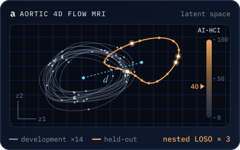

  

  
  
  
  

## About

I'm Masoud Noroozi, and I hold a Bachelor's degree in Biomedical Engineering from University of Isfahan. My long-term goal is to become a methodological research scientist or faculty member advancing AI in health. I plan to do this by developing novel AI algorithms for health and medical image processing, neuroscience, and by creating diagnostic tools based on them. I am especially inspired by questions about how algorithmic understanding can refine early identification, therapy strategies, and patient outcomes.

**Interests** · Medical Image Processing· Computer Vision · Deep Learning · Machine Learning · Neuroscience · Public Health

**Now** · Two manuscripts under review; the code for both is already public.

<!-- Optional. Remove the comment markers when you want to share it:
**Also in progress** · A systematic review and meta-analysis of AI-derived biological organ age.
-->

## Selected research

<table>
<tr>
<td width="340" valign="top">

</td>
<td valign="top">
<b><a href="https://github.com/2000noroozi/AI_HCI">Perturbation-Calibrated, Physics-Regularized Latent Representation Learning of Aortic 4D Flow MRI</a></b> 
<b>M. Noroozi</b> · <i>manuscript under review</i>, 2026
  
A label-free, leakage-controlled deviation score for whole-aorta 4D flow MRI. A 132k-parameter physics-regularized 3D VAE with a bidirectional GRU is calibrated to the severity of synthetic flow perturbations and validated by nested leave-one-subject-out across three seeds (45 models, 15 volunteers), with its failure modes reported.
  
<a href="https://github.com/2000noroozi/AI_HCI">Code</a> &nbsp;·&nbsp; <a href="https://doi.org/10.3929/ethz-b-000705347">Dataset</a>
</td>
</tr>
<tr>
<td width="340" valign="top">

</td>
<td valign="top">
<b><a href="https://github.com/2000noroozi/Scleral_vessel_segmentation">Scleral Vessel Segmentation in Visible-Light Eye Imaging using Deep Hybrid CNN-Transformer Model</a></b> 
<b>M. Noroozi</b> · <i>manuscript under review</i>
  
Artifact-aware pre-processing, one self-attention block at the U-Net bottleneck and topology-aware training. Dice 0.929, mIoU 0.870 and sensitivity 0.964 on SBVPI under image-level five-fold cross-validation, with 9.34 M parameters and 51 GMACs per image.
  
<a href="https://github.com/2000noroozi/Scleral_vessel_segmentation">Code</a> &nbsp;·&nbsp; <a href="https://sclera.fri.uni-lj.si/datasets.html">Dataset</a>
</td>
</tr>
<tr>
<td width="340" valign="top">

</td>
<td valign="top">
<b><a href="https://ieeexplore.ieee.org/document/10657181">Ensemble Learning Framework for Cardiac Systolic Abnormality Segmentation in Catheterization X-ray Images</a></b> 
<b>M. Noroozi</b>, H. Arabi, H. Zaidi · <i>IEEE NSS MIC RTSD</i>, 2024
  
Two lightweight architectures × eight losses give 16 base models, fused by six rules on 1,717 left-ventriculography frames. A 15-member consensus vote reaches Dice 0.9585, above every single model, with 0.82 M parameters in total.
  
<a href="https://ieeexplore.ieee.org/document/10657181">Paper</a> &nbsp;·&nbsp; <a href="https://doi.org/10.1109/NSS/MIC/RTSD57108.2024.10657181">DOI</a> &nbsp;·&nbsp; <a href="https://github.com/2000noroozi/Ensemble_Learning">Code</a>
</td>
</tr>
</table>

Panels are schematic illustrations drawn for this page, not patient data. Full publication list on <a href="https://scholar.google.com/citations?user=L1Na7hzkqpcC&amp;hl=en">Google Scholar</a>.

## How I report results

<table>
<tr>
<td width="50%" valign="top"><b>Leakage made visible</b> Each README states which data trained, selected and scored every model; in the latest work, the scored subject touches none of them.</td>
<td width="50%" valign="top"><b>Failure modes reported</b> Collapsed models, seed sensitivity and optimistic validation folds sit next to the headline numbers, not in a footnote.</td>
</tr>
<tr>
<td width="50%" valign="top"><b>Reproducible by default</b> Seeds, splits and every setting live in the published notebooks, with no hidden tuning.</td>
<td width="50%" valign="top"><b>Research use only</b> Code and models are for methods development, never for clinical decisions.</td>
</tr>
</table>

## Toolbox

`Python` `PyTorch` `torchvision` `TensorFlow` `Keras` `scikit-learn` `SciPy` `scikit-image` `OpenCV` `Kornia` `Captum` `TorchMetrics` `MedPy` `pandas` `Plotly` 

## Get in touch

I welcome collaborations. The quickest route is an issue on the relevant repository, or by sending an email to
✉️ 2000noroozi@gmail.com.

 

